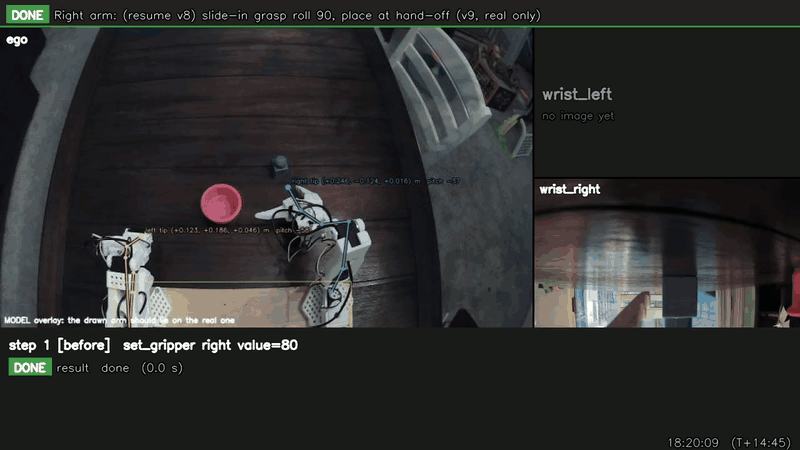
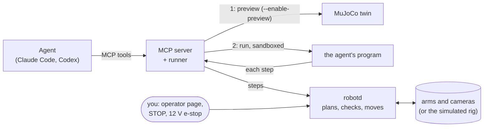

# robot-use

**A stack for controlling robots with AI agents.** You give the robot a task in plain words. An agent (Claude Code
or Codex) attempts it by writing short Python programs against the robot's cameras and arms. What works is saved as
a **skill**, and the agent applies that skill every time the task comes up again. Every motion passes through a
safety daemon before a servo moves.



*An agent's program on the real rig: the right arm sets the block down at a hand-off spot, and the left arm picks it up there and drops it
into the pink cup. Each frame is the program's own record: the step, the camera views, and a checkpoint where the
agent looked and refined its estimate.*

## Why

- **A much faster on-ramp.** Unbox the robot, describe the task, and it does something useful. There is no data
  collection or training first.
- **It gets better from its own attempts.** The agent turns its failures into skills it keeps.
- **Every run produces real-world data** (programs, traces, camera keyframes) that can train System 1 policies
  directly. This could be the beginning of the end of teleoperation as the main way to collect robot data.

It is not a replacement for diffusion policies or other learned controllers. It complements them, and the stack is
stronger with both.

## The loop

1. **You give a task**, for example "put the blue block in the pink cup".
2. **The agent makes attempts.** It looks through the cameras and writes a program. The program runs on the robot,
   with checkpoints where the agent looks again and continues, refines or aborts. (With `--enable-preview`, each
   program runs first in a MuJoCo twin.)
3. **It saves what it learned as a skill.** A first success is discovery, so it is saved as a draft. Once the
   draft has run cleanly twice in a row on different layouts, and you approve it, it becomes a validated skill.
4. **It applies the skill every time** the task, or a larger task built from it, comes up again.

## Hardware

The fully implemented robot today is a **bimanual SO-101**: two SO-101 follower arms, an ego camera between them and
a wrist camera on each, run from a Jetson Orin (any Linux or macOS machine works for the simulated rig). The SO-101 is
simply the first arm supported. Robot-specific code sits behind robotd's arm and camera interfaces, and the geometry
lives in one measured file (`robot.yaml`), so the architecture is meant to scale to more hardware.

## How it works

An LLM agent drives the arms only by writing Python programs. A safety daemon, robotd, plans and checks every motion
before any servo moves. Each program runs in a sandbox; with `--enable-preview` it runs first in a MuJoCo twin. For
the details, the switches
(motion, approval, preview) and their defaults, see **[docs/ARCHITECTURE.md](docs/ARCHITECTURE.md)**.



What keeps it safe:
- **The checks:** robotd refuses an unsafe motion and never clips it. It checks joint limits, the table, obstacles,
  the other arm and the gripper's own shape along the whole path. A contact monitor stops a push and backs off.
- **The program sandbox:** the agent's programs can reach nothing but their own steps. There are no files, no
  network and no shell.
- **You:** a live operator page with the cameras and a big STOP. On the real arms, the 12 V supply is the e-stop.

## Getting started: the simulated rig (no hardware, about 15 minutes)

You need Linux (x86_64 or aarch64, kernel 6.7+ for the full sandbox) or macOS on Apple silicon, plus:
- [uv](https://docs.astral.sh/uv/) (it installs Python 3.12+ for you);
- [Claude Code](https://claude.com/claude-code) (or Codex), logged in.

**1. Get the code and its dependencies.**

```bash
git clone https://github.com/tensortron/robot-use.git
cd robot-use
uv sync --extra dev
```

**2. Fetch the SO-101 model and write the agent's permissions for this machine.**

```bash
uv run python tools/fetch_so101_assets.py      # the MuJoCo model, into ~/.cache/robot-use/so101_mujoco
uv run python tools/setup_agent_ws.py          # agent_ws/.agents/settings.json: what the agent may read and run
```

**3. Check the machine.** This prints anything that is missing, and the fix for it.

```bash
uv run python tools/doctor.py
```

**4. Start the simulated rig.** This starts robotd and the MCP server; leave it running.

```bash
uv run python tools/run_sim.py                 # a new layout each run; --seed N repeats one
```

Programs run directly on the simulated arms. Add `--enable-preview` to run each one in a MuJoCo twin first (the agent
is told which way it works).

Open the operator page it prints (http://127.0.0.1:8772/): you see the cameras, each program as it runs, and STOP.

**5. Start the agent in another terminal, and give it a task.**

```bash
cd agent_ws
claude                                         # or: codex
```

> put the blue block in the pink cup

The agent looks through the cameras, writes a program, and watches it run. You'll see each motion on the operator
page. When it is done, it reports what happened and saves what it learned as a draft skill in
`agent_ws/.agents/skills/`.

**6. Make it a skill.** Restart the sim (Ctrl-C, then step 4 again) for a new layout, and give the agent the same task.
After two clean runs in a row, the agent asks you to approve the skill. From then on, it uses the skill whenever the
task comes up.

What the stack records (robotd's log, every program with its trace and keyframes) goes to `~/.tensortron/robot-use/`.

> **Sim and real differ.** Grasps in MuJoCo are not grasps on a real arm. A skill learned in the sim is a starting
> point for the rig, not a validated skill there.

## Getting started: the real arms

**Only move the real arms with a person at the 12 V supply.** Cutting the 12 V is the e-stop.

1. **Build the rig:** two SO-101 follower arms, three USB cameras, a 12 V
   supply, a Linux machine. Give the arms and cameras stable device names with the udev rules
   ([docs/HARDWARE_SETUP.md](docs/HARDWARE_SETUP.md)). Mind the USB camera bandwidth ([docs/usb-bandwidth.md](docs/usb-bandwidth.md)).

   **Print the calibration checkerboard** too: [`assets/checkerboard_9x6_25mm.pdf`](assets/checkerboard_9x6_25mm.pdf),
   on A4 landscape at 100% (not "fit to page"). Check that a square measures 25 mm, and stick it to something flat
   and stiff, such as foam board. The camera calibration needs it, and a tape measure.
2. **Install the hardware extra:** `uv sync --extra dev --extra hardware` (lerobot, pinned). Then run
   `uv run python tools/doctor.py --hardware`.
3. **Calibrate:** the arms, the tape measurements and the camera, in one guided page in your browser. It writes
   lerobot's calibration files and `robot.yaml` ([docs/CALIBRATION.md](docs/CALIBRATION.md) says what each step
   produces):

   ```bash
   uv run python tools/calibrate.py                   # then open http://127.0.0.1:8098/
   uv run python tools/calibrate.py --camera-only     # the measurements and the camera only: the arms are never
                                                      # touched, and may be off
   uv run python tools/calibrate.py --host 0.0.0.0    # serve the page on the LAN: http://<robot-host>:8098/
   uv run python tools/calibrate.py --trial           # write into a trial folder; the real files stay as they are
   ```

   Stop the rig (`run_rig.py`) first: the calibration needs the arms and the camera to itself. The page listens on
   127.0.0.1 unless `--host` says otherwise, because it has no login and can turn an arm's torque off. From another
   machine, use `--host 0.0.0.0` on a network you trust (safest with `--camera-only`), or an SSH tunnel
   (`ssh -L 8098:localhost:8098 <user>@<robot-host>`). The options combine, e.g. `--trial --camera-only`.

   A camera estimate (tape and datasheet) is enough to start. The lens and pose steps make the camera exact.
4. **Check it** on the operator page's overlay (next step, read-only): the drawn arms must lie on the real ones.
5. **Start it read-only first**, then with motion:

   ```bash
   uv run python tools/run_rig.py                     # robotd reads and plans, moves nothing
   uv run python tools/run_rig.py --enable-motion     # you approve each program on the operator page
   uv run python tools/run_rig.py --enable-motion --approval none
                                                      # programs run without your approval (still a person at 12 V)
   uv run python tools/run_rig.py --enable-motion --enable-preview
                                                      # each program runs in the MuJoCo twin first
   ```

   By default programs go straight to the arms, after robotd's checks; `--enable-preview` adds the twin.

   Then `cd agent_ws && claude`, as in the sim.

## Documentation

| Doc | Contents |
|---|---|
| [docs/ARCHITECTURE.md](docs/ARCHITECTURE.md) | The processes, how a program becomes motion, the safety layers, every switch with its default |
| [docs/EMBODIMENTS.md](docs/EMBODIMENTS.md) | Beyond the SO-101: how the library and the robot description would extend to other bodies (a proposal) |
| [docs/AGENT_SANDBOX.md](docs/AGENT_SANDBOX.md) | How the agent's programs are boxed in, per platform |
| [agent_ws/AGENTS.md](agent_ws/AGENTS.md) | The operating agent's brief, including how skills are drafted, validated and refined |
| [lib/robot_use/README.md](lib/robot_use/README.md) | The library the agent's programs use |
| [docs/HARDWARE_SETUP.md](docs/HARDWARE_SETUP.md) | Building the rig: what to buy, power and USB order, device names (udev) |
| [docs/SAFETY.md](docs/SAFETY.md) | The safety rules, and how robotd enforces them |
| [docs/usb-bandwidth.md](docs/usb-bandwidth.md) | Why three cameras can't all stream at full size on one USB 2.0 bus |
| [docs/CALIBRATION.md](docs/CALIBRATION.md) | Calibrating a rig: the arms, the measurements, the camera (`tools/calibrate.py`) |
| [docs/camera-calibration.md](docs/camera-calibration.md) | How this rig's lenses were measured: field of view and distortion |
| [docs/troubleshooting.md](docs/troubleshooting.md) | Failure modes seen in practice and their fixes |
| [docs/environment.md](docs/environment.md) | A Jetson Orin environment: JetPack, CUDA, torch pins |
