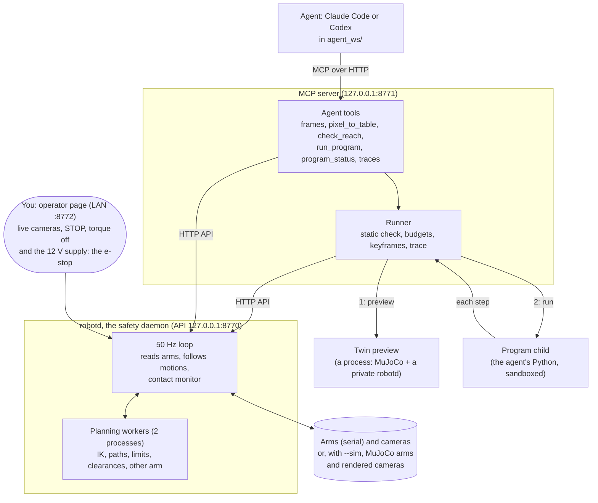

# Architecture

How the stack is put together: the processes that run, how a program written by an agent becomes motion, what
keeps it safe, and the switches that change its behaviour. **Keep this file current**: any change to a process, to
how they talk, or to a switch or its default updates it in the same commit (AGENTS.md, Conventions). The safety
rules are in [SAFETY.md](SAFETY.md); how the stack would extend to other robots, in [EMBODIMENTS.md](EMBODIMENTS.md).

## The processes



| Process | Started by | Owns | Talks to |
|---|---|---|---|
| **robotd** (`python -m stack.robotd`) | you; `tools/run_sim.py` for the sim | the serial ports (exclusively) and the cameras; the 50 Hz loop; two planning worker processes | its API on 127.0.0.1:8770 (local only); the operator page on :8772 (LAN) |
| **MCP server** (`python -m stack.mcp_server`) | you; `tools/run_sim.py` | the agent's tools; the **runner** inside it | the agent (127.0.0.1:8771); robotd's API |
| **Twin preview** | the runner, once per program | a MuJoCo world and a private robotd on a free port | nothing else: it reports back to the runner |
| **Program child** | the runner, once per program | the agent's code, in a three-layer sandbox | only the runner, over two pipes |
| **Agent** (Claude Code, Codex) | you, in `agent_ws/` | its brief, skills and task | only the MCP server |

## A program's path

```mermaid
sequenceDiagram
    participant A as Agent
    participant M as MCP server + runner
    participant T as Twin preview
    participant C as Program child (sandboxed)
    participant R as robotd
    A->>M: run_program(code, scene)
    M->>M: static check (imports, no open/exec/eval)
    M->>T: the same program, objects where the program believes they are
    T-->>M: report: ok, or the step that failed and why
    M->>R: register the program (approval per approval_mode), take the lease
    M->>C: start the program
    loop every robot_use call (move_to, close, move_by, ...)
        C->>M: one step: "right tip to this pose", "close the gripper"
        M->>M: budgets; keyframes before
        M->>R: the step
        R->>R: plan it (IK, path, limits, clearances): refused if unsafe, never clipped
        R->>R: run it at 50 Hz, contact monitor watching
        R-->>M: result: done, contact, refused with the reason, grasped
        M->>M: keyframes after; trace
        M-->>C: the result (the program decides what next)
    end
    A->>M: program_status / checkpoint answers / get_program_trace
```

**Who decides what.** The *program* decides what to do next (its own logic, reading results and checkpoints). The
*runner* does not plan: it checks budgets, records, and forwards each step unchanged. **robotd** decides *how* to move
and *whether it is safe*: it turns each step into a trajectory, checks it along the whole path, runs it, and has the
final say. A **checkpoint** pauses the program (the arms held) until the agent, having looked at the camera views,
answers continue, refine or abort.

## The operator page

robotd's page on the LAN (:8772, `stack/robotd/operator.html`, one self-contained file, re-read on each page load). It
fills the window: a header bar that says whether it is safe right now (motion, approval mode with `none` shown as
UNATTENDED, backend, loop health, faults, the running program and where it is) with a large **STOP** (also the Escape
key); the cameras on the left, always in view; and a right panel of collapsible cards that alone scrolls: approvals
waiting (forced open), the running program (its step, or "waiting at checkpoint", and its latest motions), one card
per arm (joint bars against their ranges, load and current, the gripper, a torque switch that only turns torque off,
with confirmation: torque comes on only with a motion), a timeline of recent programs and their motions (grasp, not
settled, until-conditions, refusals with the reason, STOPs, the outcome), and the system (warnings, loop, cameras).
It reads `/state`, `/limits`, `/programs` and `/history`; the runner tells robotd where a program is with
`POST /program/progress` (lease-checked, local API only). Nothing on the page can energise an arm.

## What stops a bad motion

In order: the **twin preview**, when it is on (`--enable-preview`), rejects a program whose steps fail in
simulation; **robotd's checks** refuse a step
(joint limits, the floor and board, obstacles, the other arm, the jaw collision shapes); the **contact monitor** stops
a push (lag and current) and backs off; the **budgets** end a runaway program; the **operator page's STOP**; and the
**12 V supply**, the real e-stop. The agent cannot reach robotd, the hardware, files or the network except through
its tools: its permission settings (rendered by `tools/setup_agent_ws.py`) deny the shell and the stack, and its
programs run in the **sandbox** (a static check, a Python audit hook, and a kernel box: Landlock on Linux, Seatbelt on
macOS; [AGENT_SANDBOX.md](AGENT_SANDBOX.md)).

## The simulated rig

`python tools/run_sim.py` starts robotd with `--sim` and the MCP server together. robotd is unchanged; only its arms
and cameras differ: MuJoCo arms stepping in real time (`SimArmIO`), a scene file's objects
(`stack/twin_mujoco/scenes/`, placed from a seed), and cameras rendered from `robot.yaml`'s camera models, so
`pixel_to_table` holds on them. It opens no device. The objects' true positions never reach the API: the agent finds
them with the cameras, as on the rig. `tools/doctor.py` says what a machine is missing.

## Where things are recorded

Outside the repository and outside the agent's folder (the agent may neither read nor edit them; it sees its own
programs through `get_program_trace` and `get_keyframe`):

| What | Where |
|---|---|
| robotd's event log (and the launchers' copies of robotd's and the MCP server's output) | `$ROBOT_USE_HOME/agent_logs/` |
| programs and episodes: `code.py`, `trace.jsonl`, `keyframes/` | `$ROBOT_USE_HOME/episodes/<date>/[<episode>/]<program>/` |
| the simulated rig's logs and episodes | `$ROBOT_USE_HOME/sim/` |
| calibration: captures, progress, trials, and the backups of `robot.yaml` (they hold the camera pose) | `$ROBOT_USE_HOME/calibration/` |

`ROBOT_USE_HOME` defaults to `~/.tensortron/robot-use`. A twin preview records into a temporary folder named in its
report.

## Switches

| Switch | Where | Values | Default (repo) | Unattended rig run | Effect |
|---|---|---|---|---|---|
| **motion** | `motion_enabled` in robotd's config; `--enable-motion` (robotd, `run_rig.py`) | off / on | **off** (read-only) | on, via `--enable-motion` | off: robotd reads and plans but moves nothing. `--sim` turns it on (nothing physical) |
| **approval** | `approval_mode` in robotd's config; `run_rig.py --approval` | `first_motion`, `every_motion`, `none` | **`first_motion`** | **`none`** (`--approval none`) | `first_motion`: a human approves each program once on the operator page; `every_motion`: every motion; `none`: no approval (needs `mcp_localhost_only: true`). A blocked arm always needs re-approval. The sim uses `none` |
| **step mode** | `run_program(..., step_mode=True)` | off / on | off | off | every step of that program waits for a human's approval |
| **twin preview** | `run_rig.py` / `run_sim.py --enable-preview`; MCP `--no-preview`; per program `run_program(..., skip_preview=True)` | on / off for the session / skipped per program | **off** with the launchers (`--enable-preview` turns it on); on for `python -m stack.mcp_server` alone, when the SO-101 MuJoCo model is installed | off | on: each program runs in the twin first, and a failed preview rejects it. Off: no program is previewed, the agent's instructions and `run_program` say it works directly on the live robot, and the approval card says so. Per program, the agent can skip it (the human is told) |
| **contact monitor** | `contact.mode` in robotd's config | `act`, `record_only` | `act` | `act` | `act`: stop and back off on contact; `record_only`: log only |
| **idle rest** | `idle_rest_s` | seconds | 600 | 600 | an arm held this long without a command goes slowly to rest |
| **localhost only** | `mcp_localhost_only` | true / false | false | true (`run_rig.py` always) | required for `approval_mode: none`; the MCP server must then be bound to 127.0.0.1 |
| **agent surface** | MCP `--surface`, `--tools` | `agent` / `debug`; `all`, `joint`, `cartesian` | `agent`, `all` | `agent`, `all` | `agent`: programs only; `debug`: direct motion tools, for people |
| **budgets** | the runner (`Budgets`) | steps, queries, seconds | 50 steps, 100 queries, 180 s of motion, 900 s wall clock, 2 failures in a row | the same | a program exceeding one is stopped |
| **backend** | robotd `--mock` / `--sim` / neither | hardware, mock, sim | hardware | hardware | which arms and cameras; also chooses the program sandbox (sim may use files-only Landlock on old kernels) |
| **scene, seed** | `--scene`, `--seed` (sim; `run_sim.py`) | a scene name or file; an integer | `block_cup`, a new seed each run | - | the sim's objects and their layout |
| **data folder** | `ROBOT_USE_HOME`; robotd `log_dir`; MCP `--episodes`; `run_sim --home` | a path | `~/.tensortron/robot-use` | the default | where everything is recorded |
| **rendering** | `MUJOCO_GL` | `egl`, `cgl`, `osmesa` | probed (`python -m stack.twin_mujoco.render`) | `egl` | the sim's cameras |
| **ego camera model** | `robot.yaml`, `cameras.ego` | calibrated (its `intrinsics_file`, `extrinsics_file`) or estimated (its own numbers: `eye_m`, `tilt_down_deg`, `yaw_deg`, `roll_deg`, `fov_h_deg` or `distortion`) | calibrated (this rig's `calib/`) | calibrated | the overlay, `pixel_to_table`, the sim's ego camera. A file wins over the numbers beside it; lens and pose are chosen separately. An estimate shows as a warning on the operator page and in `doctor` ([CALIBRATION.md](CALIBRATION.md)) |

robotd's config is the repository's `stack/robotd.yaml`, the one source. The launchers (`tools/run_rig.py` for the
real arms, `tools/run_sim.py` for the simulated rig) apply a session's choices to it (motion, approval, the ports, the
recording folders) in a temporary copy, so no separate config file can fall behind it. Geometry never lives there: it
is `robot.yaml`'s.

## Starting it

| | Command | Starts |
|---|---|---|
| the real rig | `tools/run_rig.py [--enable-motion] [--approval none]` | robotd on the arms (after checking the devices are present and free) and the MCP server; Ctrl-C stops both |
| the simulated rig | `tools/run_sim.py [--seed N]` | robotd `--sim` and the MCP server |
| the launcher, without hardware | `tools/run_rig.py --mock` | robotd with mock arms and the MCP server |
| calibration | `tools/calibrate.py [--trial [DIR]] [--camera-only]` | a guided page (127.0.0.1:8098) for the arms, the measurements and the ego camera; needs robotd stopped (it opens the arms and the camera itself) and writes lerobot's calibration files, `robot.yaml` and `calib/` ([CALIBRATION.md](CALIBRATION.md)) |

Both launchers first check that the operating agent's rendered permissions (`agent_ws/.agents/settings.json`, the pi
config) are what the reviewed templates give on this machine, and refuse to start when they are stale, listing the
rules that would change (`run_rig.py --mock` only warns). They never write them: rendering is
`tools/setup_agent_ws.py`'s job.

Then the agent: `cd agent_ws && claude` (or `codex`).
